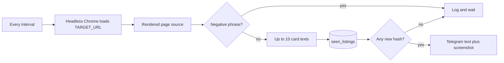

# CROUS Housing Monitor

**A polite poller for [trouverunlogement.lescrous.fr](https://trouverunlogement.lescrous.fr) that sends a Telegram message and a screenshot when a new listing appears.**

The search page is an Angular app, so a plain HTTP client never sees the results. Each check opens the filtered URL in headless Chrome, reads the rendered text, and compares listing cards with a local SQLite history. The same listing is not sent again. The monitor is meant to watch one person's own search, on a slow interval, not to scrape the catalogue.

| | |
| --- | --- |
| Author | Djoud El Hak Belkhir · [djihad-elhak](https://github.com/djihad-elhak) |
| Licence | [MIT](LICENSE) |
| Runtime | Python 3.12 on GitHub Actions; 3.11+ locally |
| Alert channel | Telegram Bot API |

There is no `.env.example` in the tree. The block under [Configure](#configure) is the whole configuration surface.

---

## Contents

- [What a check does](#what-a-check-does)
- [Repository layout](#repository-layout)
- [Requirements](#requirements)
- [Telegram](#telegram)
- [Configure](#configure)
- [Run](#run)
- [GitHub Actions](#github-actions)
- [Detection](#detection)
- [Dedup](#dedup)
- [What gets sent](#what-gets-sent)
- [Configuration reference](#configuration-reference)
- [Limitations](#limitations)

---

## What a check does



One Chrome process is started per check and quit afterwards, including when the check throws. Five failures in a row send a single Telegram warning. The counter resets after a successful check, and the warning is not repeated on the sixth failure.

Startup always runs one check immediately, then sleeps on the schedule.

---

## Repository layout

```text
.
├── main.py                 # loop, --once, --duration
├── scraper.py              # Chrome, via Selenium Manager
├── analyzer.py             # empty-state phrases and card text
├── notifier.py             # Telegram sendMessage and sendPhoto
├── storage.py              # SHA-256 dedup in SQLite
├── config.py               # environment and the 30s floor
├── utils.py                # logs/, screenshots/, filenames
├── requirements.txt
├── seen_listings.sqlite3   # committed; Actions writes it back
├── .github/workflows/monitor.yml
├── LICENSE
└── README.md
```

`logs/` and `screenshots/` are created at startup and gitignored. `.env` is gitignored. The SQLite file is not: the Actions job commits it so the next run remembers what was already sent.

---

## Requirements

- Python 3.11 or newer, and `pip`
- Google Chrome or Chromium on the machine that runs the checks. The driver is not installed by hand. Selenium Manager resolves it; if that fails, `webdriver-manager` is the fallback

```bash
pip install -r requirements.txt
```

Pinned floors in `requirements.txt`: Selenium 4.20, webdriver-manager 4, python-dotenv, BeautifulSoup 4.12, requests, loguru, schedule.

---

## Telegram

1. In Telegram, open **@BotFather**, send `/newbot`, and copy the token.
2. Send any message to that bot so a chat exists.
3. Open `https://api.telegram.org/bot<token>/getUpdates` and read `chat.id`.

That id is `TELEGRAM_CHAT_ID`. A group id works if the bot has been added to the group and has received a message there.

---

## Configure

```bash
# .env  — never commit this file
TELEGRAM_TOKEN=123456:replace-me
TELEGRAM_CHAT_ID=123456789
TARGET_URL=https://trouverunlogement.lescrous.fr/tools/47/search?bounds=...&locationName=Paris
CHECK_INTERVAL_SECONDS=60
HEADLESS=true
PAGE_LOAD_WAIT_SECONDS=8
DB_PATH=seen_listings.sqlite3
```

`TARGET_URL` is the important one. Set the city, price and room filters in the browser on [trouverunlogement.lescrous.fr](https://trouverunlogement.lescrous.fr), then paste the resulting address. The default, used only when `TARGET_URL` is unset, is the Paris search baked into `config.py`:

```text
https://trouverunlogement.lescrous.fr/tools/47/search?bounds=2.224122_48.902156_2.4697602_48.8155755&locationName=Paris
```

`CHECK_INTERVAL_SECONDS` below 30 aborts the process. Sixty seconds or more is the intended pace: one Chrome session, no parallel fetches.

`MAX_RETRIES` is read into `CONFIG` and never used. A failed check is not retried inside the same tick.

---

## Run

```bash
python main.py                 # immediate check, then forever
python main.py --once          # one check, then exit
python main.py --duration 840  # poll until 840 seconds have passed
```

`--duration` is what Actions uses. The process still checks once before entering the loop. `Ctrl+C` stops a local run.

Logs go to stderr and to `logs/crous_YYYY-MM-DD.log`, rotated at 10 MB.

A detached local process:

```bash
nohup python main.py > output.log 2>&1 &
```

`systemd`, `tmux` or a small VPS is more reliable across reboots. The workflow below is the path this repo actually uses for an always-on watch without a server.

---

## GitHub Actions

[`.github/workflows/monitor.yml`](.github/workflows/monitor.yml) is the scheduler.

| | |
| --- | --- |
| Runner | `ubuntu-latest`, Python 3.12, 25 minute job timeout |
| Each run | `python main.py --duration 840` (about 14 minutes at a 60s interval) |
| Then | commit `seen_listings.sqlite3` if it changed, and start the next run with `gh workflow run` |
| Backup cron | `7,37 * * * *` (minute 7 and minute 37), in case the chain stops |
| Manual | `workflow_dispatch` |
| Concurrency | group `crous-monitor`, `cancel-in-progress: false` |

The cron is not the main loop. A successful job starts its successor immediately. Two runs will not overlap; a second one waits in the concurrency group. A failed job does not start a successor. The next cron slot, at most about half an hour later, is what picks the chain back up.

The commit step runs even when the poll fails (`if: always()`). The follow-up dispatch runs only on success. Pushing the database does not retrigger the workflow: the triggers are schedule and `workflow_dispatch` only. The `[skip ci]` trailer in the commit message has nothing to listen for it.

Repository secrets:

| Secret | Required |
| --- | --- |
| `TELEGRAM_TOKEN` | yes |
| `TELEGRAM_CHAT_ID` | yes |
| `TARGET_URL` | yes in Actions |

Set `TARGET_URL` in secrets. The workflow always exports the variable, and an empty value does not fall through to the Paris default in `config.py`. `CHECK_INTERVAL_SECONDS=60` and `HEADLESS=true` are fixed in the workflow file, not secrets.

`permissions.contents: write` is what allows the bot commit. `actions: write` is what allows `gh workflow run`. The git identity on those commits is `crous-bot <crous-bot@users.noreply.github.com>`.

Screenshots taken on the runner are not stored. They are uploaded to Telegram and then discarded with the runner disk. Only the SQLite history survives.

---

## Detection

`analyzer.py` lowercases the visible text and collapses whitespace.

A page is treated as empty when it contains any of:

- `aucun logement trouvé`
- `aucun résultat`
- `0 logement`

If none of those match, it is treated as non-empty when it contains `logement trouvé`, `logements trouvés`, or `résidence`. Negative phrases are tested first, so the "aucun logement trouvé" empty state does not also count as a hit.

If neither list matches, any of these selectors that yields an element with more than 20 characters of text counts as a listing:

```text
[class*='fr-card']
[class*='result-item']
[class*='listing-card']
article
```

The first selector that matches is the one that is used. At most 10 cards are kept. Each card's text is collapsed and cut at 150 characters on a word boundary.

`résidence` is a weak signal. If the chrome of the page contains that word while the true empty state uses new copy, the monitor can alert on a page with nothing to rent. When the markup changes, inspect a real card and put a tighter selector at the top of `CARD_SELECTORS`.

When no card matches but the page still looks non-empty, the only "detail" is the fixed sentence `Listings detected — open the link to view details.`

---

## Dedup

`storage.py` stores SHA-256 of that detail string, the string itself, and `first_seen`, in `seen_listings` (`DB_PATH`, default `seen_listings.sqlite3`).

A row is inserted the moment it is judged new, before Telegram is called. A crash between the insert and a failed send still counts as seen: that listing is not retried on the next tick.

Consequences:

- The hash is the truncated card text, not a CROUS id. A small edit on the card alerts again. The same listing, word for word, does not.
- Cards past the tenth are invisible until they move into the first ten.
- The generic fallback sentence hashes to one row. After a single alert, further checks that still cannot see cards stay silent, even if the set of listings changed.

The committed database is that history. It holds the alert text, not only the hash. On a public repository those snippets are public. Delete rows, or stop committing the file, if that is not acceptable. Doing either will cause those listings to be notified again.

---

## What gets sent

On new rows, `notifier.py` posts an HTML message:

- a bold heading, `New CROUS Housing Listing(s)!`
- the count of new details (this can be higher than the number of lines shown)
- at most five bullets, HTML-escaped
- a link whose href is `TARGET_URL`

Then a second call, `sendPhoto`, with caption `Latest screenshot` and the PNG from `screenshots/listing_YYYYMMDD_HHMMSS.png`. The screenshot is taken only when there is something new. A text failure does not cancel the photo attempt. Either failure is logged and swallowed; the check still counts as successful, so the failure counter stays at zero.

The fifth consecutive exception sends a plain-text message: the monitor has failed five checks in a row, plus the last exception string. That string can include a page or driver error. It does not include the Telegram token.

---

## Configuration reference

| Variable | Default | Used |
| --- | --- | --- |
| `TELEGRAM_TOKEN` | none; required | Bot API URL |
| `TELEGRAM_CHAT_ID` | none; required | `chat_id` |
| `TARGET_URL` | Paris search URL in `config.py` | `driver.get`, and the link in the message |
| `CHECK_INTERVAL_SECONDS` | `60` | schedule period; exit if `< 30` |
| `HEADLESS` | `true` | `--headless=new` unless set to something other than `true` |
| `PAGE_LOAD_WAIT_SECONDS` | `8` | wait until `body` has text; then a fixed extra 3 seconds |
| `DB_PATH` | `seen_listings.sqlite3` | SQLite file |
| `MAX_RETRIES` | `3` | loaded, never read |

Page load timeout on the driver is 30 seconds, independent of `PAGE_LOAD_WAIT_SECONDS`. Chrome is started at 1920×1080, `lang=fr-FR`, with a normal desktop user agent. The scraper does not use stealth or a proxy.

---


